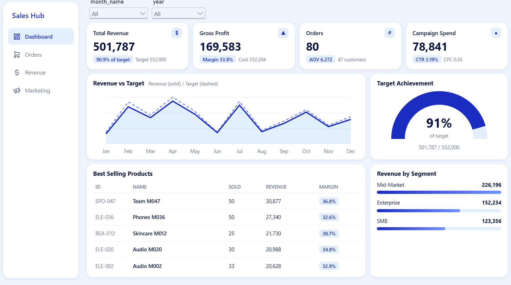
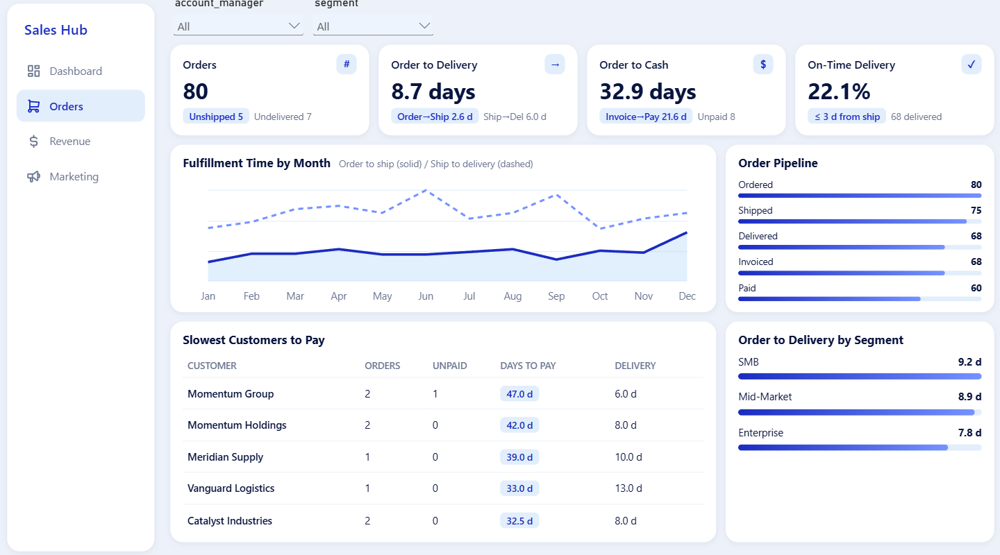
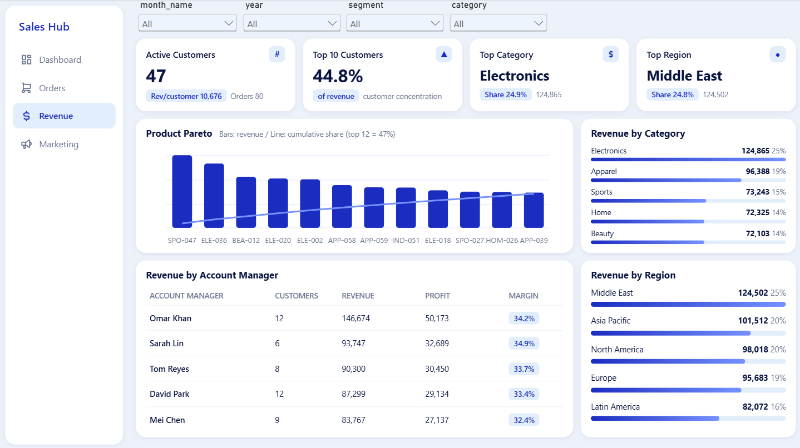
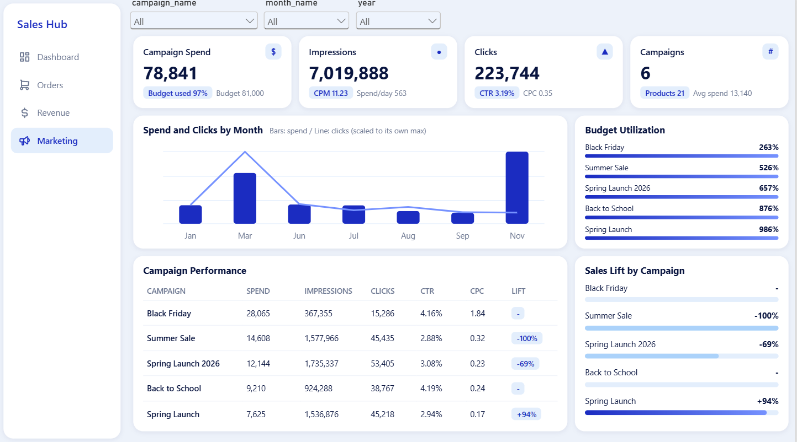
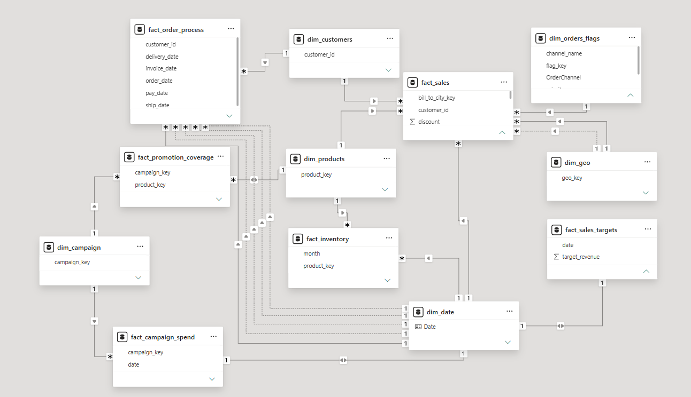

# 📊 Sales & Marketing Performance Analysis

An end-to-end data analytics project built with **Power BI** to analyze sales performance, customer behavior, order fulfillment, revenue distribution, and marketing campaign efficiency. The project focuses on turning business data into actionable insights that support better decision-making.

---

## 📌 Project Overview

This project explores four key business areas:

- 💰 **Sales Performance:** Revenue vs. target, customer segments, product performance, and profitability.
- 📦 **Order Fulfillment:** Order status progression, shipping and delivery times, and payment delays.
- 🌍 **Revenue Analysis:** Customer concentration, regional performance, product categories, and account manager performance.
- 📣 **Marketing Analytics:** Campaign spending, clicks, CTR, CPC, CPM, budget utilization, and sales growth.

---

## 🎯 Business Objectives

- Identify revenue gaps against business targets.
- Understand which customer segments and products contribute most to revenue.
- Evaluate order fulfillment efficiency and identify operational bottlenecks.
- Analyze customer payment behavior and cash collection cycles.
- Measure customer concentration and regional revenue distribution.
- Compare marketing campaign efficiency and identify potential budget optimization opportunities.
- Translate findings into actionable recommendations for business growth.

---

## 🛠️ Tools & Technologies

- 📊 **Power BI** — Interactive dashboards and data visualization.
- 🧹 **Power Query** — Data preparation and transformation.
- 📐 **DAX** — Measures, KPIs, and business calculations.
- 🗂️ **Data Modeling** — Relationships and analytical model design.

---

## 🔗 Project Links

- 📊 **Power BI Service Dashboard:** [View Interactive Dashboard]([INSERT_POWER_BI_SERVICE_LINK_HERE](https://app.powerbi.com/view?r=eyJrIjoiMTU2YjY3NWEtMjZlNS00NGEwLWE4Y2YtZTAzMTkyZjI0MDJjIiwidCI6IjZhYWE0MDU0LTgzNGEtNGJiMi1hYzIwLWRkM2E0NmJiMzg5MiJ9))

---

## 📈 Dashboard Pages

### 1. 💰 Sales Overview

Provides a high-level view of revenue performance, customer segments, product contribution, and marketing spend relative to gross profit.

**Key Insights:**

- Revenue reached **501,787**, falling approximately **9.1% below the target** of 552,000.
- The Mid-Market segment contributed approximately **45% of total revenue**.
- Revenue was distributed across multiple products rather than being dominated by a single product.
- Marketing spend represented approximately **15.7% of revenue**.

**📷 Dashboard Preview**

---

### 2. 📦 Order Fulfillment & Payments

Analyzes the order lifecycle from placement to payment, highlighting delivery delays and cash collection efficiency.

**Key Insights:**

- Average Order-to-Ship time was **2.6 days**.
- Average Ship-to-Delivery time was **6.0 days**, making post-shipment delivery the main fulfillment bottleneck.
- Of 80 orders, 60 reached the paid stage.
- The average Order-to-Cash cycle was **32.9 days**.
- Invoice-to-Payment time averaged **21.6 days**.
- The SMB segment had the longest average shipping-to-delivery time among the three customer segments.

**📷 Dashboard Preview**

---

### 3. 🌍 Revenue & Customer Analysis

Examines revenue distribution across customers, regions, product categories, and account managers.

**Key Insights:**

- The top 10 customers generated approximately **44.8% of total revenue**.
- Revenue was distributed across five regions, with the Middle East contributing approximately **25%**.
- Electronics was the largest product category, generating **124,865**, or approximately **24.9% of revenue**.
- The top 12 products accounted for approximately **47% of revenue**.
- Account managers showed differences in total revenue and revenue per customer, highlighting opportunities for further performance analysis.

**📷 Dashboard Preview**

---

### 4. 📣 Marketing Campaign Performance

Evaluates campaign efficiency, spending distribution, engagement, and budget utilization.

**Key Insights:**

- Black Friday accounted for approximately **36% of total marketing spend**, while generating around **7% of recorded clicks**.
- Back to School achieved a **4.19% CTR** and a **0.24 CPC**.
- Spring Launch recorded a CPC of approximately **0.17**.
- Campaign-level budget utilization showed significant variations that require validation against the original budget data.
- Similar Spring Launch campaign names and matching monthly totals indicate a potential campaign naming or data consistency issue.

**📷 Dashboard Preview**

---

## 🧩 Data Modeling

The data model supports analysis across sales, orders, customers, products, regions, account managers, and marketing campaigns.

**📷 Data Model & Relationships**

---

## 💡 Business Recommendations

- 🎯 Investigate the revenue gap and identify the months and segments contributing most to the shortfall.
- 🚚 Review delivery operations after shipment to reduce fulfillment delays.
- 💳 Investigate customers with extended payment cycles to improve cash collection.
- 📊 Evaluate account manager performance using customer count, revenue, and revenue per customer.
- 📣 Review Black Friday spending efficiency and assess campaign performance using conversion and revenue metrics alongside clicks.
- 🧹 Validate campaign names, budget definitions, and delivery service-level agreements before making final operational decisions.

---

## ⚠️ Data & Analysis Considerations

- The on-time delivery KPI uses a provisional **3-day delivery threshold**. This should be replaced with the actual business service-level agreement.
- Marketing campaign names and budget figures require validation before drawing definitive conclusions.
- Campaign sales growth figures may be affected by missing comparison periods or inconsistent records.
- Marketing spend compared with gross profit is an indicative comparison, not a final net profit calculation. Other operating expenses may not be included.

---

## 👨‍💻 Author

**Ahmed Alaa**

Aspiring Data Analyst focused on transforming raw data into meaningful insights using Power BI, SQL, Excel, and data visualization.

- 💼 [LinkedIn Profile](INSERT_LINKEDIN_URL_HERE)

